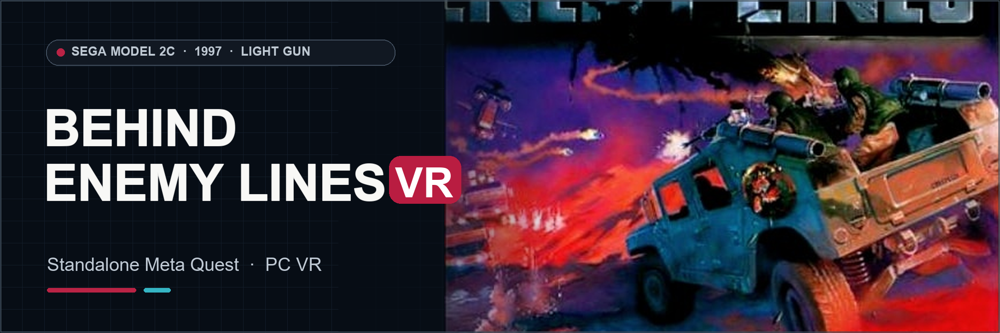

# Behind Enemy Lines VR
### Sega Model 2C Arcade Combat · Standalone Meta Quest & PC VR

**[Download Quest, Windows OpenXR, source and checksums](https://github.com/vr4all-standalone/behind-enemy-lines-vr/releases/tag/v0.1.2-beta)**

**[🌐 VR4ALL — Standalone VR Mod Installer](https://github.com/vr4all-standalone/vr4all-standalone)**  
**[☕ Donate to VR4ALL](https://ko-fi.com/vr4all)**

## v0.1.2-beta

- Gun, World, System and In-game settings tabs with Advanced pages. In-game opens native Service.
- One controller owns the settings pointer. A contact dot marks its hit. Laser offers Off, Normal, 5x and 10x.
- Either hand can Start solo play. The free trigger can take over after releasing the active trigger. Start on the free hand joins P2, then the saved layout takes over.
- How to Play uses Start and Fire, with an inward trigger callout.
- Wider View Off clips to the original viewport. Both modes share the same gameplay world size and HUD policy.

Requires your own original arcade game files. Includes standalone Quest and Windows OpenXR builds.

---

## The port

Behind Enemy Lines VR adapts Sega's Model 2C combat gun game for stereo VR with head tracking and tracked guns. The original game supplies the mission, scenery, audio and cabinet rules. Standalone Quest 3/3S and Windows OpenXR are the target platforms.

Quest 3S gameplay, shooting, audio and recoil have been observed in development. The port preserves the original ammo and warning displays, adds a world-depth native reticle, and provides VR4ALL settings for player hands, view, HUD and reticle size. The latest refinements and full game routes are still being checked.

## Your game files

Bring your own `bel.zip` with all **31 verified original payloads**. No separate billboard firmware or CHD is required for this set. The port validates file sizes and checksums. Neither this page nor future software downloads contain the original game.

## Install

Use [VR4ALL](https://github.com/vr4all-standalone/vr4all-standalone/releases) to choose your owned `bel.zip`, download this port's Quest APK and transfer all 31 original ROM payloads into the app's `files/roms` folder. Open **Behind Enemy Lines - VR4ALL** and complete its ROM validation. For Windows OpenXR, extract the PCVR ZIP, put your owned archive in its `roms` folder, and run `run-pcvr.cmd`. The beta defaults use 35%/145% In-game reticle size, 10.0 m shrink distance and 120% HUD size; saved choices remain intact until Reset to defaults.

## Development notes

The Quest app name is **Behind Enemy Lines - VR4ALL**. Quest 3S play has been observed on a preceding build. The approved default changes and Windows OpenXR package pass software checks but still need physical play checks; remaining game routes are also unverified. This is an independent fan project, not affiliated with Sega or Meta.

[Original flyer and banner attribution](docs/github/ARTWORK.md)
